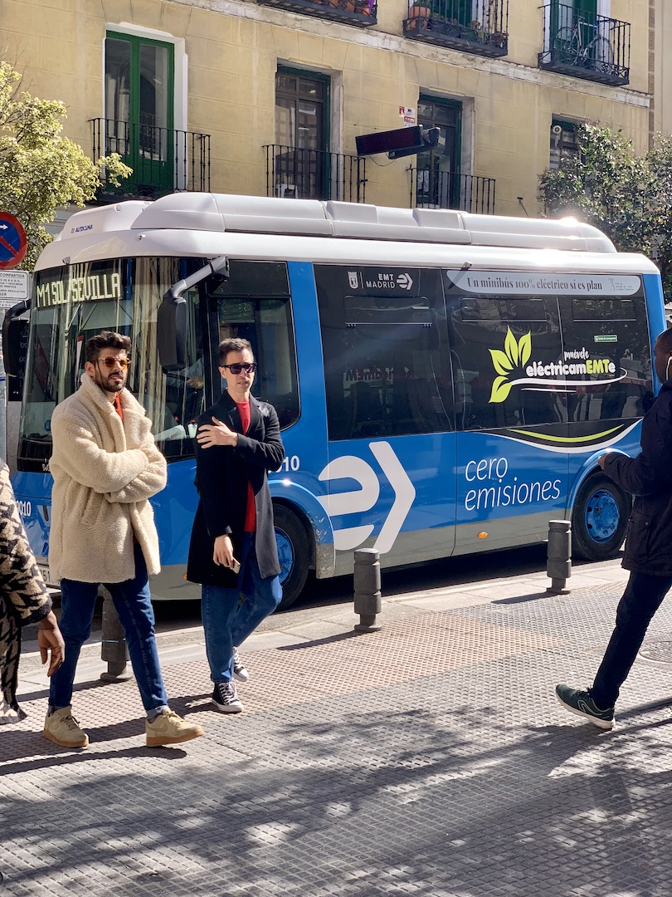

# 🐸 Blind Navigator for Raspberry Pi

A voice-guided walking assistant for blind and visually-impaired users, built for **Raspberry Pi 5** (works on Pi 4 / 3 too, CPU-only).

**Concept:** a "guide dog" in software — the camera continuously detects obstacles and announces them in Hungarian, the user talks to it (voice commands, no button needed), and a vision-capable LLM answers through a speaker: *what's in front of me*, *help me stay on the sidewalk*, *read this label aloud*.



## ✨ Features

| Feature | How it works |
|---|---|
| 🎥 **Real-time object detection** | YOLOv8-nano runs continuously on the Pi CPU (~1–2 fps). Objects are announced with a rough distance class: *"ember előttem kb. 2-3 méterre"* (person in front, ~2–3 m). Same object is repeated at most once per 30 s unless its distance class changes. |
| 👂 **Always-listen voice commands** | Continuous mic listening with an energy-based VAD (adaptive noise-floor calibration, cheap on CPU). Speech → [Whisper](https://github.com/openai/whisper) STT (Hungarian) → intent routing. |
| 🧭 **Navigation & sidewalk guidance** | *"Szeretnék körbesétálni a tömbnél"* / *"a járdára akarok menni"* → vision LLM gives short, danger-first walking guidance (max 2 sentences). |
| 🔘 **Button mode (optional)** | Short press = full scene description; long press (2 s, BCM 17 → GND, header pins 11 + 9) = navigation guidance. |
| 📖 **Read & explain** | *"Olvasd fel, mi van rajta"* → reads product labels, handwritten notes, signs aloud. If it can't read it, it says so — **it never invents**. |
| 🪵 **Debug logging** | Every analyzed frame, every spoken answer and every recognized command is saved with timestamps (`/var/lib/blindnav/log/YYYY-MM-DD/`) and auto-uploaded to your server every 15 min. |

### Demo videos
- [Full dialogue demo — 6 everyday scenarios](docs/media/blindnav-full-demo.mp4) *(scene, walk around the block, crossing, read/explain, movement, shop entrance)*
- [Simulated sidewalk walk](docs/media/blindnav-walk-demo.mp4) *(parked cars, bushes, gap behind the panel-blocks)*
- [Reading tests](docs/media/blindnav-reading-demo.mp4) *(food box, fish can, handwritten note)*

## 🧠 Architecture

```
        ┌──────────────────── Raspberry Pi ────────────────────┐
        │  blindnav.service     ← voice commands + button      │
  mic ──│  listen.service       ← always-listen (VAD→STT)      │── speaker
        │  blindnav-detect      ← YOLOv8n continuous detection │
        └───────────────┬──────────────────────────────────────┘
                        │ HTTP (multipart: question + photo)
                        ▼
        Your server (e.g. behind Tailscale):
        • /ask endpoint: vision LLM + TTS  →  Hungarian MP3
        • Whisper STT endpoint (8012)
```

The Pi is intentionally **thin**: capture → send → speak. All heavy AI (vision LLM, TTS, STT) runs on a server you control, so a Pi 5 on CPU is enough. (Optional upgrade: Hailo-8 M.2 accelerator boosts detection to ~30 fps with the same software — detection runs through Ultralytics, which supports Hailo.)

## 📦 What you need

| Item | Notes |
|---|---|
| Raspberry Pi 5 (or 4/3) + SD card | 4 GB+ RAM recommended for the detection model |
| Camera | CSI camera (rpicam) **or** USB webcam — auto-detected |
| USB **speaker** | Pi 5 has no analog jack — use USB audio |
| USB **microphone** | for always-listen voice commands (optional; button or `--test` mode work without) |
| GPIO button (optional) | 2-pin button between header pins **11 (BCM 17)** and **9 (GND)** |
| Powerbank 5V/3A+ (USB-C PD) | ~4–6 h walking on a 10 000 mAh pack |
| **A backend server** | any machine reachable from the Pi that exposes: (1) a vision-LLM+TTS endpoint, (2) a Whisper STT endpoint. Our reference implementation is a small FastAPI app fronting Gemini + edge-tts + faster-whisper (see below). |

## 🚀 Install

### 1. Flash Raspberry Pi OS (64-bit) with Raspberry Pi Imager
In Imager's OS customization (⚙️): set hostname `pi5`, username/password, **Wi-Fi credentials**, and **enable SSH**.

### 2. Copy this repo to the Pi and run the installer
```bash
git clone https://github.com/petyus-/Blind-Navigator-Pi.git
cd Blind-Navigator-Pi/src
bash install.sh
```
The installer:
- creates `/opt/blindnav-venv` (Ultralytics YOLOv8n + onnxruntime, ~10 min on Pi)
- installs three systemd services: `blindnav.service`, `blindnav-detect.service`, `blindnav-listen.service`
- writes `/etc/blindnav.conf` (only if absent — your config survives upgrades)
- installs the debug-log uploader (15-min rsync to your server; set up passwordless SSH or skip logging)

### 3. Configure the server endpoints
Edit `/etc/blindnav.conf`:
```ini
SERVER_IP=192.0.2.10        # your LLM+TTS server (LAN or Tailscale IP)
PORT=5014                   # /ask endpoint port (multipart question/photo/lang -> mp3)
STT_PORT=8012               # Whisper STT endpoint
ALWAYS_LISTEN=1             # voice-only mode (no button needed)
DETECT_FPS=1                # detection rate (1 fps = battery friendly)
CONF=0.45                   # YOLO confidence threshold
IMGZ=320                    # YOLO input size (320 = fast on CPU)
LOG=1                       # debug logging + auto-upload
```

### 4. Reference backend (what the endpoints expect)
- **`POST http://SERVER:PORT/ask`** — `multipart/form-data`:
  - `question` (text), optional `photo` (JPEG bytes), `lang` (e.g. `hu`)
  - response: `audio/mpeg` — the **spoken Hungarian answer** (vision-LLM + TTS in one call)
  - question-only requests work as plain text-to-speech
- **`POST http://SERVER:STT_PORT/v1/audio/transcriptions`** — OpenAI-compatible Whisper endpoint, `language=hu`

Any stack exposing these two HTTP contracts works — ours is a ~100-line FastAPI app (Gemini vision → edge-tts `hu-HU-NoemiNeural`) behind [Tailscale](https://tailscale.com) so the Pi can reach it from anywhere.

## 🗣 Voice commands (Hungarian)

| You say | Mode |
|---|---|
| „Mi van előttem?" | full scene description |
| „Szeretnék körbesétálni a tömbnél" / „…elindulni" | walk/navigation guidance |
| „a járdára akarok menni" | sidewalk navigation (danger-first, max 2 sentences) |
| „Olvasd fel, mi van rajta" / „Mit ír ez a cédula?" | OCR read-out |
| „Mi ez?" | object identification |

Unknown or too-short utterances are answered with *„Nem értem, ismételd"* — it never guesses.

**Safety rule baked into every prompt:** *tell the user only what you actually see; if unsure, say so; danger first; max 2 sentences.*

## 🔍 How it talks (distance classes)

Bounding-box height ratio → rough distance class (single camera, no depth sensor):
- `bbox_h > 55 %` of frame → *„közvetlenül előttem"* (right in front)
- `25–55 %` → *„előttem kb. 2-3 méterre"* (2–3 m)
- `< 25 %` → *„távolabb"* (further away)

~36 common COCO classes are mapped to Hungarian names (person → ember, car → autó, dog → kutya, …). For metric distance, a ~2000 Ft ToF sensor (VL53L1X) is a planned v3 add-on.

## 🪵 Debugging a walk

Every frame, answer and command is logged with timestamps and auto-uploaded to your server (`/home/<user>/blindnav-logs/YYYY-MM-DD/`). Review it after each test walk, tune `CONF`, `DETECT_FPS` and the sidewalk prompt in `blindnav.py`.

## 🛠 Troubleshooting

| Symptom | Fix |
|---|---|
| No answer spoken | `curl http://SERVER:PORT/ask -F question=teszt -F lang=hu -o t.mp3` from the Pi — if silent, the backend is down/unreachable |
| Detection slow | keep `IMGZ=320`, `DETECT_FPS=1`; Pi 4/3 will be slower than Pi 5 |
| Mic not found | `arecord -l` to check; add user to `audio` group; install.sh does `usermod -aG audio pi` |
| **SD boot issues** | flash with Raspberry Pi Imager; enable SSH + Wi-Fi in the customization step |
| Powerbank cuts out | use a PD-capable 5V/3A pack; cheap packs switch off on low draw |
| Camera ` Busy` errors | only one service may capture at a time; `blindnav-detect` and `blindnav.service` share via distinct frame times |

## 🗺 Roadmap
- [ ] ToF sensor (VL53L1X) for real meter distances
- [ ] Hailo-8 M.2 acceleration (~30 fps detection)
- [ ] Local LLM fallback (Qwen 3B on NVMe) for offline walks
- [ ] Romanian voice output (STT/TTS both support `ro`)
- [ ] Return-to-home guidance

## 📜 License
MIT — see [LICENSE](LICENSE).

*Built for a blind 80+ father walking the panel-block streets of Târgu Mureș. 🐸*
